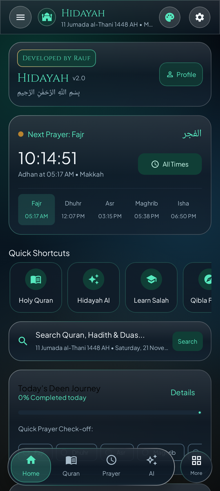
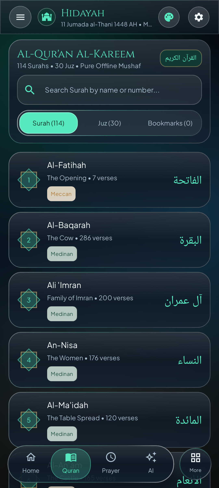
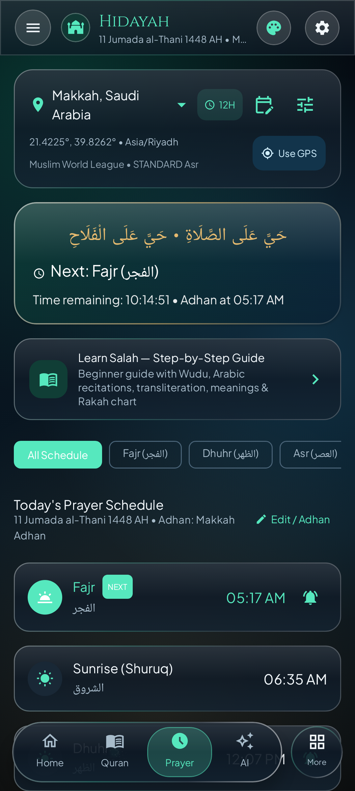
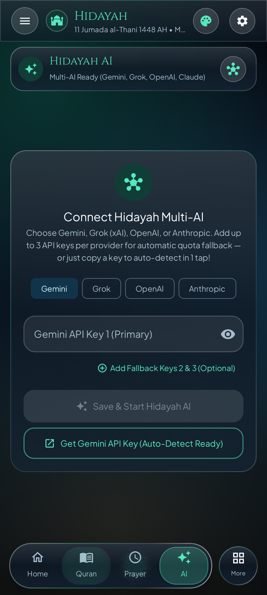
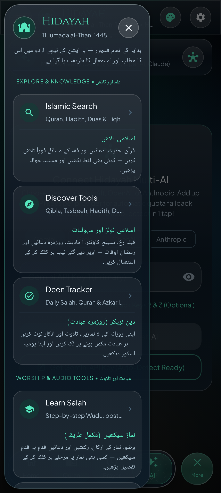
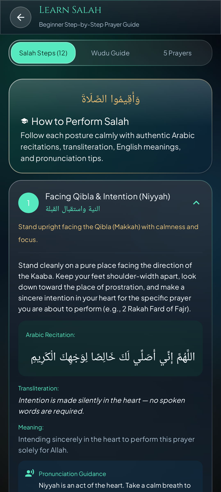
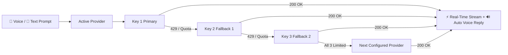

<div align="center">

<!-- Header -->
<br />

### بِسْمِ اللَّهِ الرَّحْمَٰنِ الرَّحِيمِ

# 🌙 Hidayah — Complete Muslim Lifestyle & AI Companion

**An ultra-smooth, offline-first Android app built with Kotlin, Jetpack Compose & Liquid Glass Material 3**  
*Offline Holy Quran • Online Quran Audio • Hidayah Multi-AI with Voice Chat • Prayer Times • Real Adhan • Qibla • Learn Salah • Deen Tracker*

<br />

<!-- Live Dynamic GitHub Badges -->
[](https://github.com/mansoorwanimansoorwani23-collab/Al-Quraan-deen-apk/actions/workflows/build-apk.yml)
[](https://github.com/mansoorwanimansoorwani23-collab/Al-Quraan-deen-apk/releases/latest)
[](https://github.com/mansoorwanimansoorwani23-collab/Al-Quraan-deen-apk/releases)
[](https://github.com/mansoorwanimansoorwani23-collab/Al-Quraan-deen-apk/commits/main)
[](https://github.com/mansoorwanimansoorwani23-collab/Al-Quraan-deen-apk)
[](https://github.com/mansoorwanimansoorwani23-collab/Al-Quraan-deen-apk/stargazers)

<br />

<!-- Quick Navigation -->
[📸 Screenshots](#-app-screenshots) •
[📥 Download APK](#-download-latest-apk) •
[✨ Features](#-key-features) •
[🤖 Hidayah AI](#-hidayah-ai--multi-provider-3-key-fallback--voice-chat) •
[🛠️ Languages & Stack](#️-languages-frameworks--tech-stack) •
[🏛️ Architecture](#️-architecture--project-structure) •
[🚀 Build Locally](#-getting-started--local-build)

<br />

[-GitHub%20Releases-0F766E?style=for-the-badge&logo=android&logoColor=white)](https://github.com/mansoorwanimansoorwani23-collab/Al-Quraan-deen-apk/releases/latest)

</div>

---

## 📸 App Screenshots

> Captured directly from **Hidayah v2.0** running on Android (Pixel 8 • Liquid Glass Material 3).

<div align="center">

| 🏠 Home Dashboard | 📖 Pure Offline Quran (114 Surahs) | 🕌 Prayer Times & Real Adhan |
| :---: | :---: | :---: |
|  |  |  |
| *Live prayer countdown, shortcuts & Deen journey* | *114 Surahs, 30 Juz, bookmarks & Arabic Mushaf* | *GPS local times, Makkah Adhan & Hijri date* |

<br />

| 🤖 Hidayah Multi-AI (4 Providers) | 🧭 "More" Drawer with Urdu Guides | 🎓 Learn Salah Step-by-Step |
| :---: | :---: | :---: |
|  |  |  |
| *Gemini, Grok, OpenAI & Claude • 3 keys each* | *Clear Urdu explanations under every tool* | *12 Salah steps, Wudu guide & Arabic recitations* |

</div>

---

## 🌟 About Hidayah

**Hidayah** is an all-in-one Muslim lifestyle Android application engineered for smooth 60fps performance—even on low-end devices. Designed around a custom **Liquid Glass Material 3** interface, it brings together offline Quran reading, online Quran audio with exact resume, local astronomical prayer timings, real Adhan alerts, an interactive Qibla compass, Learn Salah, Deen tracking, and **Hidayah AI** (multi-provider Islamic AI with voice messaging and 3-key automatic quota failover).

> **Community Dedication:** *Developed by Rauf — Especially for Pushpora Masjid and Madrasa Community.*

---

## 🛠️ Languages, Frameworks & Tech Stack

<div align="center">

<!-- Languages & Core Android -->


<!-- Architecture, Storage & Networking -->


<!-- Multi-AI Ecosystem -->


</div>

<br />

| Layer | Technology & Version |
| :--- | :--- |
| **Primary Language** | Kotlin `2.2.10` (Coroutines, Flow & StateFlow) |
| **UI & Design System** | Jetpack Compose (BOM `2024.09.00`) + Material Design 3 Liquid Glass |
| **Architecture** | MVVM + Unidirectional State Flow + Repository Pattern |
| **Navigation** | Jetpack Navigation Compose (`2.8.9`) + Responsive Floating Dock & Drawer |
| **Persistence** | Room SQLite (`2.7.0` with KSP `2.3.5`) & DataStore Preferences (`1.1.7`) |
| **Networking & Streaming** | OkHttp (`4.10.0` HTTP/2 + real-time SSE), Retrofit (`2.12.0`), Moshi (`1.15.2`) |
| **Media & Speech** | Foreground Audio Playback Service, Android `SpeechRecognizer`, Neural & On-Device TTS |
| **Location & Sensors** | Google Play Services Location (`21.3.0`) + Real-Time Magnetometer Qibla Compass |
| **Testing & Snapshots** | JUnit 4, Robolectric (`4.16.1`), Roborazzi (`1.59.0`), Coroutines Test |
| **Build & Automation** | Gradle `9.3.1` (Kotlin DSL), AGP `9.1.1`, Temurin Java 17, GitHub Actions YAML |

---

## ✨ Key Features

<table>
  <tr>
    <td width="50%" valign="top">
      <h3>📖 Complete Offline Quran & Online Audio</h3>
      <ul>
        <li><strong>114 Surahs & 30 Juz Offline:</strong> Pure decorated Mushaf reader with Arabic script, translations, and customizable Quran fonts.</li>
        <li><strong>Online Quran Audio & Exact Resume:</strong> Stream renowned Qaris with a background playback notification and exact millisecond resume.</li>
        <li><strong>Recitation Practice:</strong> Dedicated practice mode to refine Tajweed and fluency.</li>
        <li><strong>Bookmarks & Instant Search:</strong> Search across Surahs, Verses, Hadith, Duas, and Fiqh in one tap.</li>
      </ul>
    </td>
    <td width="50%" valign="top">
      <h3>🕌 Local Prayer Times, Real Adhan & Qibla</h3>
      <ul>
        <li><strong>Offline Astronomical Calculation:</strong> Supports global calculation methods (MWL, ISNA, Umm al-Qura, Karachi, etc.) & Standard/Hanafi Asr.</li>
        <li><strong>Real Adhan Alerts:</strong> Authentic Adhan notifications & audio preview with customizable reminders.</li>
        <li><strong>Live Qibla Finder:</strong> Real-time sensor-based Kaaba compass.</li>
        <li><strong>GPS + Manual City Picker:</strong> One-tap GPS location detection with instant manual fallback.</li>
      </ul>
    </td>
  </tr>
  <tr>
    <td width="50%" valign="top">
      <h3>📿 Worship, Learning & Deen Tracker</h3>
      <ul>
        <li><strong>Learn Salah (12 Steps):</strong> Beginner-friendly Salah & Wudu guide with Arabic recitations, transliteration, meanings, and pronunciation tips.</li>
        <li><strong>Azkar, Duas & Hadith:</strong> Morning/Evening Azkar, daily Duas, and authentic Hadith collections.</li>
        <li><strong>Digital Tasbeeh & Ramadan Mode:</strong> Tactile Dhikr counter, Hijri calendar, and Ramadan tools.</li>
        <li><strong>Daily Deen Tracker:</strong> Quick daily prayer check-off and progress tracking right on Home.</li>
      </ul>
    </td>
    <td width="50%" valign="top">
      <h3>💎 Liquid Glass UI & Urdu Guides</h3>
      <ul>
        <li><strong>Smooth on Low-End Devices:</strong> Hardware-friendly animations, adaptive Window Size support, and zero keyboard/dock overlap across phones.</li>
        <li><strong>Curated Islamic Themes:</strong> Switch instantly between Emerald Night Glass, Light, Dark, and custom Islamic palettes.</li>
        <li><strong>Built-in Urdu Guides ("More" Drawer):</strong> Every tool in the left sidebar includes an Urdu title and clear Urdu guide explaining how to use it.</li>
      </ul>
    </td>
  </tr>
</table>

---

## 🤖 Hidayah AI — Multi-Provider, 3-Key Fallback & Voice Chat

Hidayah AI presents a clean, unified **Hidayah AI** experience up front while running a resilient multi-provider engine underneath:

- **4 AI Providers Built-In:** **Google Gemini**, **xAI Grok (Grok 3 / Grok 3 Mini / Grok 2)**, **OpenAI (GPT-4o / GPT-4.1)**, and **Anthropic (Claude 3.7 / 3.5)**.
- **3 API Key Slots per Provider (12 Keys Total):** Configure **Key 1 (Primary)**, **Key 2 (Fallback 1)**, and **Key 3 (Fallback 2)** per provider.
- **Automatic Quota & Rate-Limit Failover:** When Key 1 hits a quota or HTTP `429` error, Hidayah AI automatically switches `Key 1 → Key 2 → Key 3` (with a 5-minute cooldown) and falls back to your next configured provider seamlessly.
- **1-Tap Clipboard Auto-Detect:** Copy any `AIzaSy...`, `xai-...`, `sk-...`, or `sk-ant-...` API key and return to Hidayah AI—an instant banner detects it and saves it to the next available slot in one tap.
- **Voice Messaging + Automatic Voice Replies:** Tap the composer **Mic button** to speak in **Hindi/Hinglish**, **English**, **Urdu**, or **Arabic**. Spoken messages automatically trigger spoken AI replies with **Pause/Resume**, **-5s / +5s seek**, and **speed controls**.



---

## 📥 Download Latest APK

Every push to `main` automatically compiles and publishes a directly downloadable `.apk` under **GitHub Releases**:

1. Open the [**Latest Release**](https://github.com/mansoorwanimansoorwani23-collab/Al-Quraan-deen-apk/releases/latest) page on your phone.
2. Under **Assets**, tap the `.apk` file to download directly (uncompressed `.apk`, no ZIP needed).
3. Tap the downloaded APK and allow **"Install from unknown sources"** if prompted.

> ℹ️ *Automated release builds are debug APKs signed with an ephemeral debug keystore for testing and community distribution.*

---

## 🏛️ Architecture & Project Structure

```text
Al-Quraan-deen-apk/
├── .github/
│   └── workflows/
│       └── build-apk.yml            # Automated Debug APK build & GitHub Release workflow
├── docs/
│   └── screenshots/                 # Real Pixel 8 Compose screenshots captured via Roborazzi
├── app/
│   └── src/main/java/com/example/
│       ├── ai/                      # MultiAiProviderService, GeminiAiService, AiVoicePlayer
│       ├── audio/                   # QuranAudioPlayerManager, QuranPlaybackService, AdhanAudioPlayer
│       ├── data/                    # Room DB, offline Quran/Hadith/Dua datasets, DataStore preferences
│       ├── domain/                  # Offline astronomical prayer time calculator & domain models
│       ├── location/                # GPS & city location manager
│       ├── notification/            # Real Adhan & prayer reminder scheduler
│       ├── search/                  # Unified Islamic search engine
│       └── ui/
│           ├── components/          # Liquid Glass system, responsive floating dock, Urdu left drawer
│           ├── screens/             # Home, Quran, Prayer, AI, Salah, Discover, Search, Tracker, Settings
│           ├── theme/               # Islamic themes, typography & shapes
│           └── MainViewModel.kt     # Reactive MVVM state holder
├── gradle/
│   └── libs.versions.toml           # Centralized Gradle Version Catalog (AGP 9.1.1)
├── .gitattributes                   # GitHub Linguist multi-language detection config
├── build.gradle.kts                 # Root Gradle Kotlin DSL build config
└── settings.gradle.kts              # Project modules & repositories
```

---

## 🚀 Getting Started & Local Build

<details>
<summary><strong>Click to expand Prerequisites, Build & Test Commands</strong></summary>

### Prerequisites
- **Temurin JDK 17** or newer
- **Gradle 9.3.1** (matching AGP `9.1.1`)
- **Android SDK** (`compileSdk 36`, `minSdk 24`)

### Build & Test Steps

```bash
# 1. Clone the repository
git clone https://github.com/mansoorwanimansoorwani23-collab/Al-Quraan-deen-apk.git
cd Al-Quraan-deen-apk

# 2. Generate a temporary local debug keystore (only if ./debug.keystore is missing)
keytool -genkeypair \
  -keystore ./debug.keystore \
  -storepass android \
  -alias androiddebugkey \
  -keypass android \
  -dname "CN=Android Debug,O=Android,C=US" \
  -keyalg RSA \
  -keysize 2048 \
  -validity 10000

# 3. Build the Debug APK
gradle :app:assembleDebug --stacktrace --no-daemon

# 4. Run Unit & Robolectric Tests
gradle :app:testDebugUnitTest
```

Generated APK location:
```text
app/build/outputs/apk/debug/app-debug.apk
```

</details>

---

## ⚙️ Automated CI/CD & GitHub Releases

The workflow at [`.github/workflows/build-apk.yml`](.github/workflows/build-apk.yml) handles automated builds and releases:

- **Triggers:** Automatic on every push to `main` + manual via **Actions → Run workflow**.
- **Toolchain:** `ubuntu-latest` • Temurin **Java 17** (verified) • Exact **Gradle 9.3.1** • AGP **9.1.1**.
- **Zero-Secret Security:** Uses only `${{ github.token }}` (`contents: write`) and an ephemeral debug keystore that is never committed, cached, or uploaded.
- **Dual Backup:** Uploads `app-debug-apk` as a GitHub Actions artifact first, then publishes the uncompressed `.apk` to **GitHub Releases** as **Latest** with a unique tag (`debug-apk-build-<run>-<attempt>`).

---

## 🔒 Privacy & Permissions

- **Local-First Keys:** User API keys for Gemini, Grok, OpenAI, and Anthropic are stored locally on-device in Android DataStore and sent only to the provider you choose.
- **Offline Core:** Quran reading, prayer calculations, Learn Salah, Azkar, Duas, Tasbeeh, and Deen Tracker work completely offline.
- **Runtime Permissions Only When Needed:** Microphone (`RECORD_AUDIO`) and GPS Location are requested only when using Voice Messaging or automatic location detection.

---

## 🤝 Contributing

Contributions, translations, and suggestions are always welcome!

1. Fork this repository
2. Create your feature branch: `git checkout -b feature/your-improvement`
3. Commit your changes: `git commit -m "Add your improvement"`
4. Push to your branch: `git push origin feature/your-improvement`
5. Open a Pull Request or submit an [Issue](https://github.com/mansoorwanimansoorwani23-collab/Al-Quraan-deen-apk/issues)

---

<div align="center">

### 🤲 جزاك الله خيراً

**Developed with devotion by Rauf**  
*Especially for Pushpora Masjid and Madrasa Community*

If **Hidayah** helps you in your daily worship, please ⭐ this repository!

</div>
